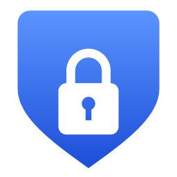
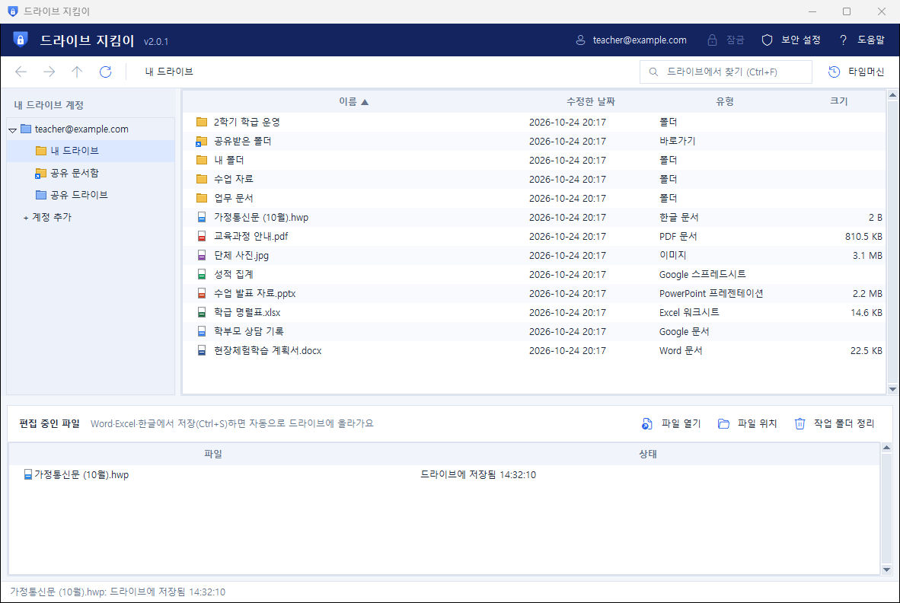

<p align="center"></p>
<h1 align="center">드라이브 지킴이 (DriveKeeper)</h1>
<p align="center"><b>구글 드라이브에 비밀번호 잠금을.</b><br>
마운트 없이, 필요한 파일만 열고 저장하면 자동으로 올라가는 Windows 프로그램</p>
<p align="center">
  <a href="https://janghwansangai.github.io/drive-keeper/"><b>홈페이지</b></a> ·
  <a href="https://github.com/janghwansangai/drive-keeper/releases/latest/download/DriveKeeper.zip"><b>내려받기</b></a> ·
  <a href="https://janghwansangai.github.io/drive-keeper/start.html"><b>따라 하기</b></a> ·
  <a href="docs/manual/DriveKeeper-Manual.pdf">사용설명서(PDF)</a> ·
  <a href="docs/manual/DriveKeeper-AI-Guide.md">AI용 설명서(MD)</a>
</p>

<p align="center"></p>

## 왜 만들었나요?

'Google Drive 데스크톱'으로 드라이브를 `G:`처럼 연결해 두면, 컴퓨터 앞에 앉은 **누구나 비밀번호 없이**
내 드라이브 전체를 열고 지울 수 있어요. 드라이브 지킴이는 그 빈틈을 메웁니다.

| | 드라이브 연결(마운트) | 드라이브 지킴이 |
|---|---|---|
| 비밀번호 | 없음 | 켤 때 · 자리 비울 때 · 절전 뒤 잠금 |
| 내 PC에 놓이는 것 | 드라이브 전체 | 지금 여는 파일만 |
| 실수/악성 프로그램이 드라이브를 지우면 | 그대로 지워짐 | **지우기 요청 자체를 막음** |
| 지운 파일·옛 버전 | 웹에서 찾아야 함 | 타임머신으로 바로 되살림 |

## 주요 기능

- 🔒 **비밀번호 잠금** — 켤 때, N분 동안 안 쓸 때, 절전에서 깨어날 때, 버튼 한 번(Ctrl+L)
- 📂 **탐색기처럼 보기** — 내 드라이브 · 공유 문서함 · 공유 드라이브, 검색, 여러 계정
- 💾 **열고 · 고치고 · 저장(Ctrl+S)** — 한글/Word/Excel로 열고 저장하면 몇 초 안에 드라이브에 올라감
- 🛡️ **지우기 차단** — 프로그램이 보내는 요청 중 삭제 · 휴지통 · 공유 변경은 코드 수준에서 막음
- 🕰️ **타임머신** — 휴지통의 파일 되살리기, 파일의 이전 버전 열기 · 되돌리기
- ⚡ **정전 · 오류에도 안전** — 저장 기록 이중 보관, 다시 켜면 못 올린 파일부터 이어서 올림
- 🧯 **랜섬웨어 의심 감지** — 파일이 이상하게 바뀌면 올리지 않고 멈춤

## 설치 (Windows 10 / 11)

1. [DriveKeeper.zip 내려받기](https://github.com/janghwansangai/drive-keeper/releases/latest/download/DriveKeeper.zip) → 압축 풀기
2. **설치하기** 두 번 클릭 (관리자 권한 필요 없음)
3. 처음 켜면 나오는 **시작 도우미**를 따라 '앱 열쇠'를 만들고 로그인

> **각자 자신의 열쇠를 씁니다.** 드라이브 지킴이에는 만든 사람의 Google 계정이나 열쇠가 들어 있지 않아요.
> 사용자가 자기 Google 계정으로 무료 '앱 열쇠(client_secret.json)'를 만들어 넣기 때문에,
> 내 파일은 **내 컴퓨터 ↔ Google** 사이로만 오가고 다른 서버를 거치지 않습니다.
> 열쇠 만드는 법은 [따라 하기 안내](https://janghwansangai.github.io/drive-keeper/start.html#key)에서 한 단계씩 그림으로 볼 수 있어요.

새 버전이 나오면 프로그램이 알려 줘요. 새 zip의 **설치하기**를 다시 누르면 설정 · 로그인은 그대로 남습니다.

## 개발자용

```bash
python -m venv .venv
.venv\Scripts\pip install -r requirements.txt -r requirements-dev.txt -r requirements-build.txt
.venv\Scripts\python app.py                      # 실행 (또는 run.bat)
.venv\Scripts\python -m unittest discover tests  # 자동 테스트
.venv\Scripts\python build_exe.py                # dist\DriveKeeper\DriveKeeper.exe
.venv\Scripts\python tools\package_release.py    # release\DriveKeeper.zip
```

| 파일 | 하는 일 |
|---|---|
| `app.py` | 화면 (Tkinter), 잠금 · 타임머신 · 도움말 · 시작 도우미 |
| `drive_client.py` | Google Drive API. `_GuardedHttp`가 허용 목록 밖 요청(삭제 · 휴지통 · 권한)을 차단 |
| `sync.py` | 저장 감지 → 업로드, 충돌 · 재시도 · 랜섬웨어 의심 보류 |
| `security.py` · `protect.py` | 비밀번호(scrypt) · 잠금, Windows DPAPI로 로그인 정보 암호화 |
| `accounts.py` · `config.py` | 여러 계정, 데이터 폴더(`%USERPROFILE%\DriveKeeper`) |
| `updater.py` | GitHub Releases에서 새 버전 확인 |
| `installer/` | 설치 · 지우기 스크립트 (현재 사용자에게만 설치) |
| `docs/` | 홈페이지 (GitHub Pages). `start.html` = 따라 하기 안내 (인쇄하면 설명서 PDF: `tools/build_manual.py`) |
| `tools/` | 화면 사진·누를 곳 자리(`make_screenshots.py` → `docs/assets/shots/spots.js`), PDF, 배포 zip |

새 버전 내기: `config.VERSION` 올리기 → exe · zip 만들기 →
`gh release create vX.Y.Z release/DriveKeeper.zip` (파일 이름은 꼭 `DriveKeeper.zip`)

Google Drive는 Google LLC의 상표입니다. 이 프로그램은 Google과 관련이 없는 개인 프로젝트입니다.
